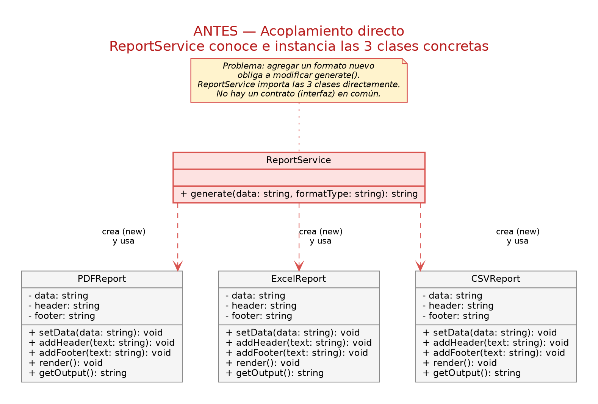
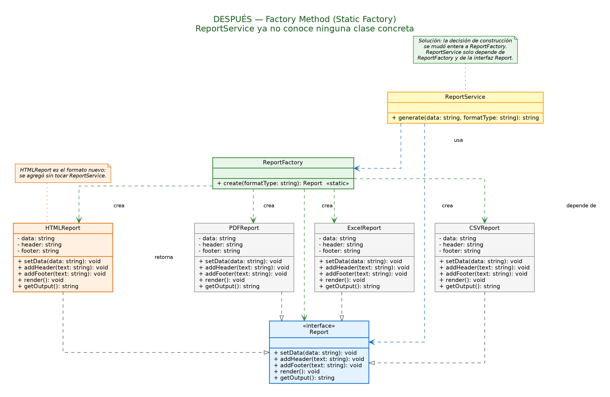

# 01 · Factory Method (creational)

## Problem

`ReportService.generate()` ([`src/before`](src/before/reportSystem.before.ts)) decided which class to instantiate with an `if / else if` chain and stored the result as `any`. Adding a new format meant editing the service, and the compiler could not check anything.

## Solution

- A `Report` interface that every format implements (`PDFReport`, `ExcelReport`, `CSVReport`, `HTMLReport`).
- `ReportFactory.create(format)` isolates the decision of *what* to instantiate.
- `ReportService` depends only on `Report`. **`HTMLReport` was added without touching `ReportService`.**

| Before | After |
|---|---|
|  |  |

## Design decisions

- **Factory Method, not Abstract Factory:** there is a single product type (`Report`) in several variants, not families of related objects that must be combined.
- **Static factory, not a full GoF creator hierarchy:** the only thing that varies is *which* class is created, not the creator's behavior. A `ReportService` subclass per format would be over-engineering for this case.

The reasoning is also written in the comment at the top of [`ReportFactory.ts`](src/after/ReportFactory.ts).

```bash
npm run demo:factory
```
