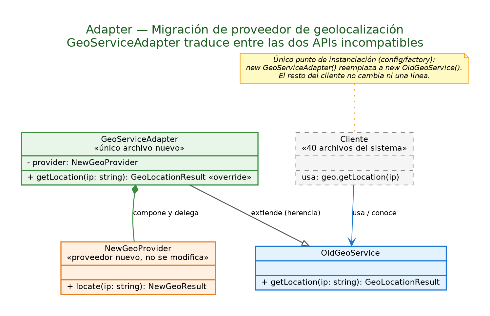

# 02 · Adapter (structural)

## Problem

About 40 files use `OldGeoService.getLocation(ip)`, which returns a flat object `{ lat, lng, city, country }`. The provider must be replaced by `NewGeoProvider`, a third-party class whose `locate(ip)` returns a nested object with different names (`coordinates.latitude`, `address.locality`, …). Rewriting 40 files is not viable, and the third-party class cannot be modified.

## Solution

`GeoServiceAdapter` extends `OldGeoService`, wraps a `NewGeoProvider` and translates its response into the shape the rest of the system expects. The only change in client code is the line that creates the instance.



## Design decisions

- **Adapter, not Facade:** the problem is two specific interfaces that don't match, not a complex subsystem that needs a simpler entry point.
- **Change is contained:** if a future provider appears with yet another shape, only the adapter changes (field type, constructor and the mapping in `getLocation()`); no other file is touched.
- The tests check both the field mapping and that the adapter is a drop-in replacement for `OldGeoService` (Liskov substitution).

```bash
npm run demo:adapter
```
