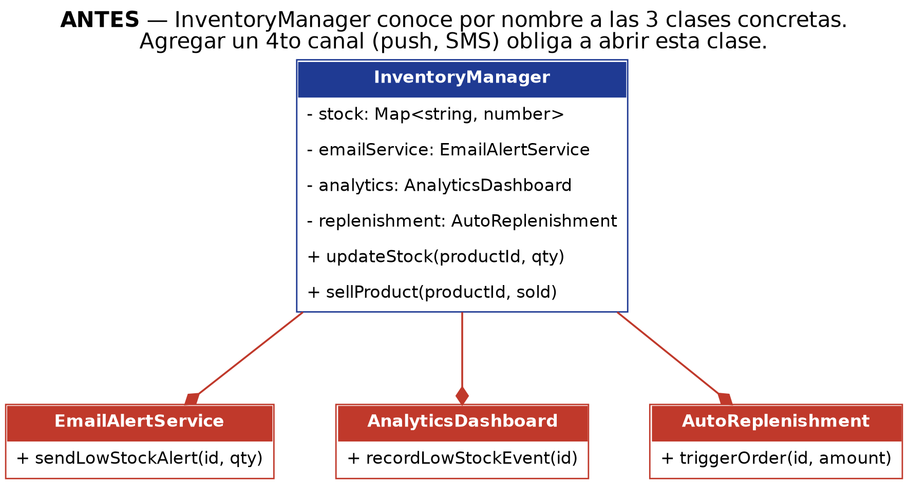
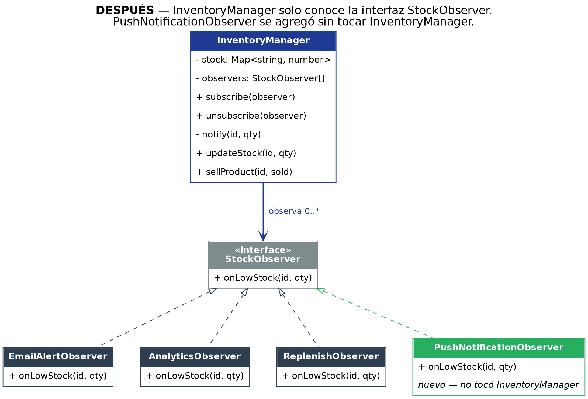

# 03 · Observer (behavioral)

## Problem

`InventoryManager` ([`src/before`](src/before/InventoryManager.ts)) created and called `EmailAlertService`, `AnalyticsDashboard` and `AutoReplenishment` by name, in two different methods. Adding a fourth channel or changing one of them meant editing a class that has nothing to do with emails or analytics.

## Solution

- `InventoryManager` keeps a list of `StockObserver` (an interface with a single method, `onLowStock()`), with `subscribe()` / `unsubscribe()`.
- Each channel is its own observer. **`PushNotificationObserver` was added without changing a line of `InventoryManager`.**

| Before | After |
|---|---|
|  |  |

## Key decision: where the `try/catch` goes

The `try/catch` wraps **each individual call inside the loop**, not the whole loop. That way a failing observer is logged and skipped, and the others still get notified. `src/main.ts` demonstrates it with a deliberately broken observer, and the test suite checks it.

Full justification (Spanish): [`justificacion.md`](justificacion.md).

```bash
npm run demo:observer:before
npm run demo:observer
```
